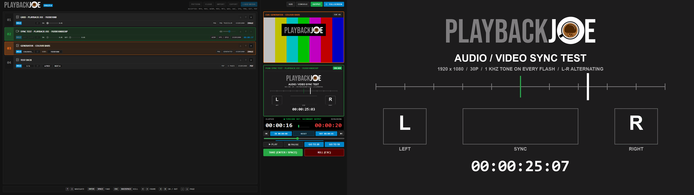
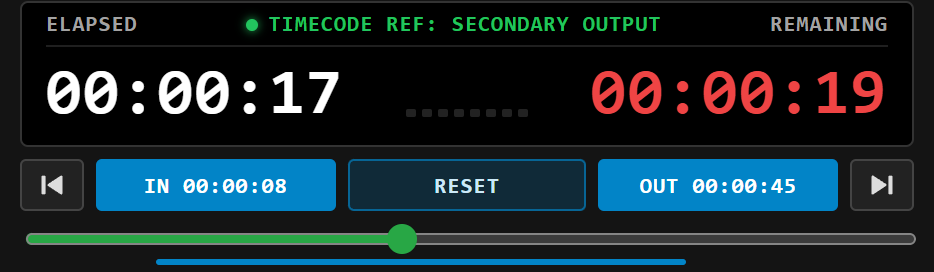
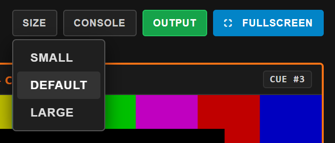
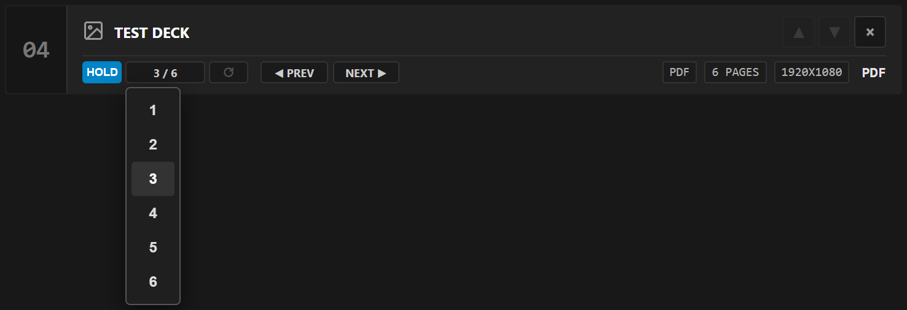
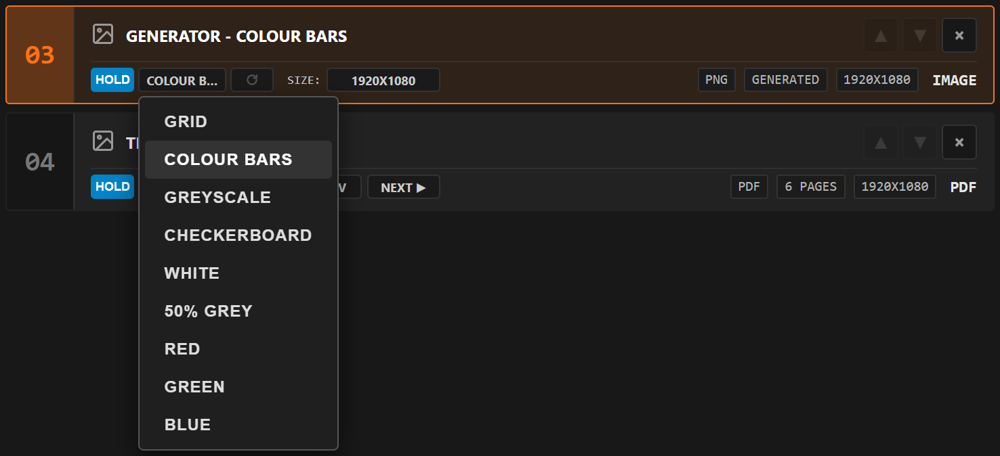

# Playback Joe
Designed by Joseph Stracuzzi

**Cue-based video, audio and image playback for live shows.** Line up your media in a cuelist, preview the next cue, and TAKE it to a clean fullscreen output on your projector or second screen, while you keep full control from the operator console.



---

## ⬇️ Download
Get the latest version from the **[Releases page](https://github.com/josephstracuzzi/playback-joe/releases/latest)**. Playback Joe is a portable app: nothing to install, just download and run.

| System | Download | How to run |
|---|---|---|
| Windows 10 / 11 (64-bit) | `Playback Joe <version> Portable.exe` | Double-click it. |
| Linux (x64) | `playback-joe-<version>.tar.gz` | Unpack it, then start `./playback-joe` from that folder. |
| macOS 10.15 or later (experimental) | `Playback Joe <version> Mac Apple Silicon.zip` (M1 and newer) or `Playback Joe <version> Mac Intel.zip` | Unzip it and move **Playback Joe** to Applications. |

The apps are not code-signed, so on first launch Windows SmartScreen says "Windows protected your PC". Click **More info → Run anyway**.

On a Mac, the first time you open it macOS says it can't check the app. Go to **System Settings → Privacy & Security** and click **Open Anyway**. If macOS says the app "is damaged", run `xattr -cr "/Applications/Playback Joe.app"` in Terminal once. If the menu bar shows over the fullscreen output, go to **System Settings → Control Center** and set **Automatically hide and show the menu bar** to **In Full Screen Only** (on older macOS, tick **Automatically hide and show the menu bar in full screen** under **Dock & Menu Bar**). The Mac version is new and hasn't been tested at a show yet.

On some Linux systems, Ubuntu 24.04 for example, the app stops at launch with a message about `chrome-sandbox`. Fix it once from the app's folder with `sudo chown root:root chrome-sandbox && sudo chmod 4755 chrome-sandbox`, or start it with `./playback-joe --no-sandbox` instead.

Your settings, your autosaved cuelist and the starter clips are kept in your app-data folder (`%APPDATA%\playback-joe` on Windows, `~/.config/playback-joe` on Linux), so they stay put when you move or replace the app file.

---

## ✨ Features

### Two windows, one show
- **Operator console** with the cuelist, a **CUE** monitor (what's next) and a **PGM** monitor (what's live).
- **Output window** that shows only your media, with no borders or controls. With a second display connected it opens fullscreen there automatically. On a single screen it opens as a 16:9 window you can move around.
- Plug in or unplug a projector mid-show and the output moves to the right screen without stopping playback.

### Cuelist
- Add video, audio, images and PDFs: **MP4, M4V, MOV, WEBM, MP3, WAV, AAC, M4A, FLAC, OGG, JPG, PNG, GIF, WEBP, BMP, PDF**. See [Supported formats](#-supported-formats) for which codecs play.
- Each cue shows its type, resolution, codec and running time.
- Per-cue **end behaviour**: **HOLD** on the last frame, **LOOP**, or **ADV**ance to the next cue.
- Per-cue **fade in and fade out** for both picture and sound.
- Per-cue **volume from 0 to 300%**, with a centre detent at 100%.
- Reorder cues with ▲▼, **IMPORT** and **EXPORT** cuelists, and everything is **autosaved** so you pick up where you left off.
- CLEAR, IMPORT, EXPORT and ADD MEDIA lock while a cue is live, so a stray click can't wreck the show.

### Playback control
- **TAKE** puts the selected cue on air. **KILL** fades picture and sound to black over a second.
- **PLAY / PAUSE**, a scrub bar, and **GO TO 20 / GO TO 10** to jump to 20 or 10 seconds before the end for rehearsals.
- **PAUSE** with nothing live puts the selected video or audio cue on air already paused, without playing a frame, so you can scrub it and set IN / OUT first.
- **Frame-accurate IN / OUT points per cue**: step to a frame with ◀| |▶ and press **IN** or **OUT**. The cue then starts at IN and ends at OUT, and its fades, HOLD, ADV and LOOP all follow the points. A trimmed cue shows its running time in blue; double-click it to clear the points.
- Large **elapsed and remaining timecode** and an audio level meter.



### Built for live use
- If a media file is missing or won't play, the output cuts to black, the cue turns red and the problem is logged, instead of the show freezing.
- A video whose picture can't be played on this computer (ProRes, for example) turns red when you add it, and TAKE won't put it on air, so it can't go out as sound over a black screen.
- If the output window crashes or hangs, it is replaced automatically.
- Switch **OUTPUT** off in the middle of a cue and the operator's PGM monitor takes over the picture and sound where the output left off. Switch it back on and the output picks the cue up again. OUTPUT on/off is remembered for the next launch.
- Only one copy of the app runs at a time, so a double-click can't open a second set of windows.
- A built-in **CONSOLE** shows a log of what happened.
- **SIZE** makes the operator console **SMALL**, **DEFAULT** or **LARGE**. The output is never affected. The size is saved with the autosave and with exported cuelists, so it comes back at the next launch or IMPORT.



### Keyboard shortcuts
| Key | Action |
|---|---|
| **↑ / ↓** | Select the previous / next cue |
| **Enter**, **Numpad Enter** or **Space** | TAKE |
| **Esc** or **Backspace** | KILL |
| **-** / **+** | Previous / next page on a live PDF cue (main keyboard or numpad) |

### PDF slides
Add a **PDF** with ADD MEDIA and it becomes one cue. Pick a page from its dropdown, or step with **◀ PREV** and **NEXT ▶**, or press **-** and **+** (main keyboard or numpad) while it's live. Pages cut instantly on the output. For a PowerPoint deck, export it as a PDF first. Animations, transitions and embedded video don't carry over.



### Test patterns
The **PATTERN** list next to CLEAR adds a test cue to the cuelist: the bundled **Grid** or **Sync Test**, or a **Generator** cue. A generator cue is a normal cue with its own pattern and size pickers: grid, colour bars, greyscale, checkerboard or a solid colour, from 720p to 4K.



### Starter cues
A fresh install opens with three test cues made for Playback Joe:
- **Grid - Playback Joe - 1920x1080**: a projector alignment grid with labelled rows and columns, centre cross and circles.
- **Sync Test - Playback Joe - 1920x1080x30p**: a one-frame flash with a beep every second, alternating left and right, for checking audio/video sync and speaker channels.
- **Generator - Colour Bars**: a generator cue set to colour bars. Change its pattern or size right on the cue.

---

## 🎞️ Supported formats
Tested with short clips in every format below, on Windows, macOS and Linux.

**Video**

| Codec | File types | Windows | macOS | Linux |
|---|---|---|---|---|
| H.264 (8-bit, 10-bit, 4:2:2, up to 4K) | MP4, M4V, MOV | ✅ | ✅ | ✅ |
| VP9 (8-bit and 10-bit), VP8 | WEBM | ✅ | ✅ | ✅ |
| AV1 | MP4, WEBM | ✅ | ✅ | ✅ |
| HEVC / H.265 | MP4, MOV | ✅ on most PCs (needs hardware support) | ⚠️ depends on the Mac | ❌ |
| ProRes, DNxHD / DNxHR, MJPEG, MPEG-2, MPEG-4 Part 2 | MOV, MP4 | ❌ | ❌ | ❌ |

A video that can't be played is marked red with **MEDIA ERROR** as soon as you add it. To use it, convert it to H.264 MP4 first (with HandBrake or Shutter Encoder, for example).

**Audio** (the same on every system)
- ✅ AAC (AAC, M4A, or inside MP4 / MOV), MP3, WAV (16-bit, 24-bit, 32-bit float), FLAC, OGG Vorbis, and Opus or Vorbis in WEBM
- ❌ AC3 / Dolby Digital (the picture plays but is silent), ALAC, AIFF

**Images:** JPG, PNG, GIF (animated too), WEBP, BMP, and PDF pages.

---

## 🛠️ Building from source (developers)
You only need this if you want to change the code. Install [Node.js](https://nodejs.org/), then in the project folder:

```bash
npm install
npm start
```

To make the portable apps yourself, run `npm run build:win` on Windows, `npm run build:linux` on Linux, or `npm run build:mac` on a Mac. The files go to the `dist/` folder.

To check which formats play on a computer, build the test clips with `tools/make-codec-clips.ps1` (needs ffmpeg, and PowerShell 7 on macOS or Linux), then run `npx electron tools/probe-codecs.js test-media/codecs`.
