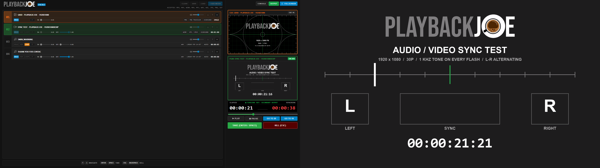

# Playback Joe v10.18.2
Designed by Joseph Stracuzzi

**Cue-based video, audio and image playback for live shows.** Line up your media in a cuelist, preview the next cue, and TAKE it to a clean fullscreen output on your projector or second screen, while you keep full control from the operator console.



---

## ⬇️ Download
Get the latest version from the **[Releases page](https://github.com/josephstracuzzi/playback-joe/releases/latest)**. Playback Joe is a portable app: nothing to install, just download and run.

| System | Download | How to run |
|---|---|---|
| Windows 10 / 11 (64-bit) | `Playback Joe 10.18.2 Portable.exe` | Double-click it. |
| Linux (x64) | `playback-joe-10.18.2.tar.gz` | Unpack it, run `chmod +x playback-joe` once, then start `./playback-joe`. |

The apps are not code-signed, so on first launch Windows SmartScreen says "Windows protected your PC". Click **More info → Run anyway**.

Your settings, your autosaved cuelist and the starter clips are kept in your app-data folder (`%APPDATA%\playback-joe` on Windows, `~/.config/playback-joe` on Linux), so they stay put when you move or replace the app file.

---

## ✨ Features

### Two windows, one show
- **Operator console** with the cuelist, a **CUE** monitor (what's next) and a **PGM** monitor (what's live).
- **Output window** that shows only your media, with no borders or controls. With a second display connected it opens fullscreen there automatically. On a single screen it opens as a 16:9 window you can move around.
- Plug in or unplug a projector mid-show and the output moves to the right screen without stopping playback.

### Cuelist
- Add video, audio and images: **MP4, M4V, WEBM, MOV, MP3, WAV, AAC, JPG, PNG, GIF**.
- Each cue shows its type, resolution, codec and running time.
- Per-cue **end behaviour**: **HOLD** on the last frame, **LOOP**, or **ADV**ance to the next cue.
- Per-cue **fade in and fade out** for both picture and sound.
- Per-cue **volume from 0 to 300%**, with a centre detent at 100%.
- Reorder cues with ▲▼, **SAVE** and **LOAD** cuelists, and everything is **autosaved** so you pick up where you left off.
- CLEAR, SAVE, LOAD and ADD MEDIA lock while a cue is live, so a stray click can't wreck the show.

### Playback control
- **TAKE** puts the selected cue on air. **KILL** fades picture and sound to black over a second.
- **PLAY / PAUSE**, a scrub bar, and **GO TO 20 / GO TO 10** to jump to 20 or 10 seconds before the end for rehearsals.
- Large **elapsed and remaining timecode** and an audio level meter.

### Built for live use
- If a media file is missing or won't play, the output cuts to black, the cue turns red and the problem is logged, instead of the show freezing.
- If the output window crashes or hangs, it is replaced automatically.
- Only one copy of the app runs at a time, so a double-click can't open a second set of windows.
- A built-in **CONSOLE** shows a log of what happened.

### Keyboard shortcuts
| Key | Action |
|---|---|
| **↑ / ↓** | Select the previous / next cue |
| **Enter**, **Numpad Enter** or **Space** | TAKE |
| **Esc** or **Backspace** | KILL |

### Starter clips
A fresh install opens with two test clips made for Playback Joe:
- **Grid - Playback Joe - 1920x1080**: a projector alignment grid with labelled rows and columns, centre cross and circles.
- **Sync Test - Playback Joe - 1920x1080x30p**: a one-frame flash with a beep every second, alternating left and right, for checking audio/video sync and speaker channels.

---

## 🛠️ Building from source (developers)
You only need this if you want to change the code. Install [Node.js](https://nodejs.org/), then in the project folder:

```bash
npm install
npm start
```

To make the portable apps yourself, run `npm run build:win` on Windows, `npm run build:linux` on Linux, or `npm run build:mac` on a Mac. The files go to the `dist/` folder.
